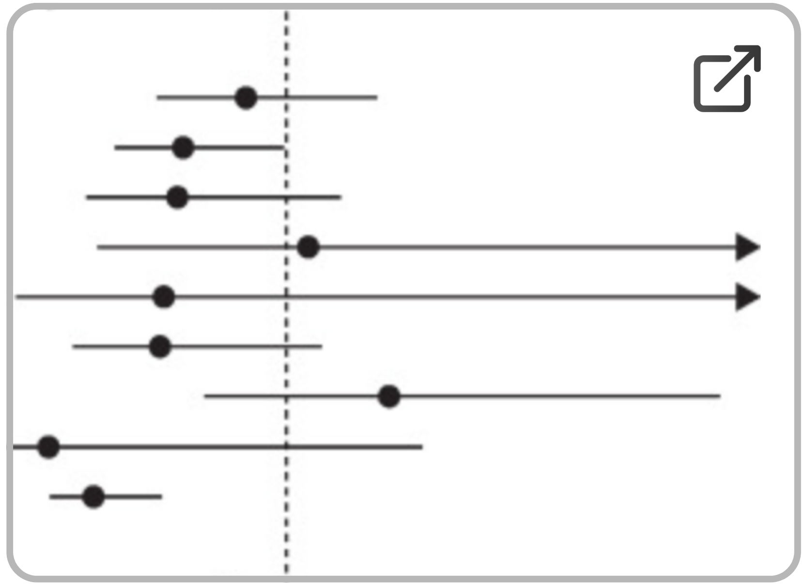
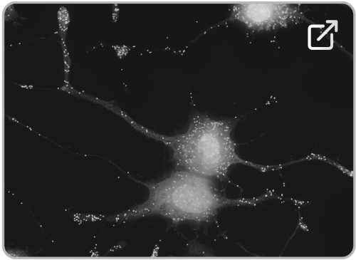
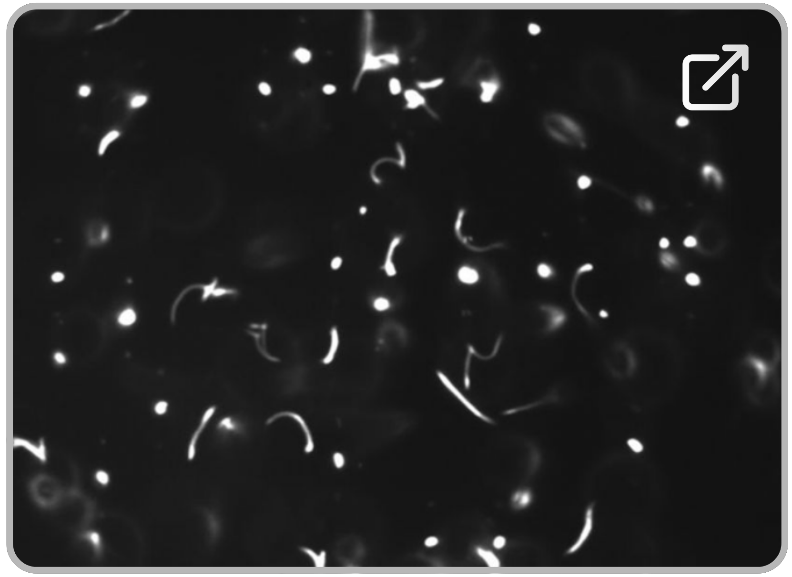
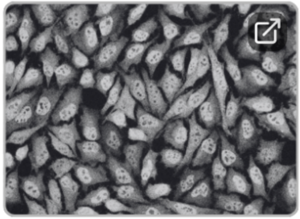
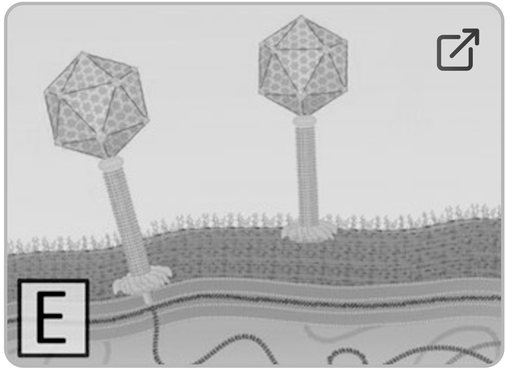
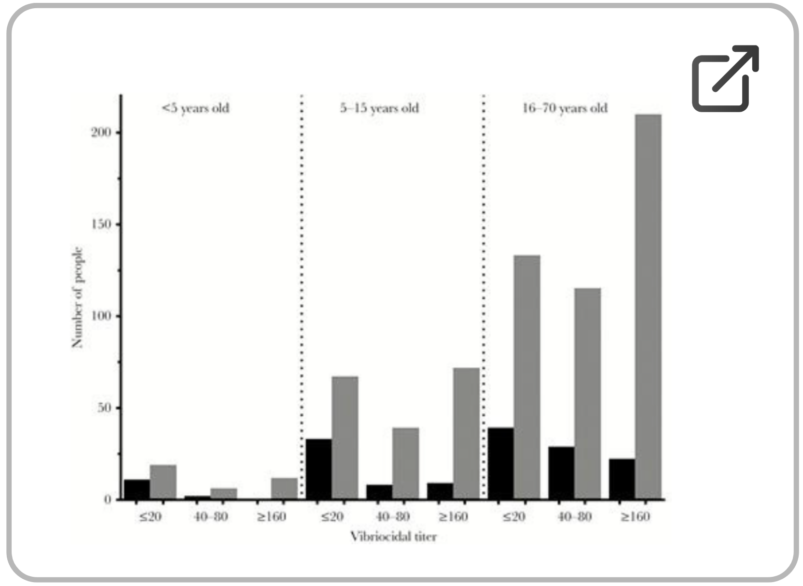

::: {style="max-width: 500px; margin: 5px auto; text-align: center; padding: 6px;"}
For a complete overview of my professional experience, download <a href="/files/CV.pdf" download="RSeykora_CV_2026.pdf" class="no-icon">CURRICULUM VITAE</a>.
:::

::: {style="max-width: 500px; margin: 10px auto; text-align: center; border: none; padding: 10px; background-color: transparent;"}
### Publications <small style="font-size: 0.7em; font-weight: normal; background-color: color-mix(in srgb, #ffd700 35%, transparent); color: inherit; padding: 1px 5px; border-radius: 3px;">(NOTE: those undergoing updates do not yet have active links)</small> {style="font-size: 1.1em; font-weight: semi-bold; margin-bottom: 5px;"}
:::

total citations 192 · h-index 6 · i10-index 5

::: {.list-table tbl-colwidths="[10, 45, 15]"}
- 

  - Year
  - Title
  - Cited By
  - View

- 

  - **2023**
  - 
    1.  **Pending citation update:** A systems serology study investigating correlates of protection against *Vibrio cholerae* infection.
  - 6
  - {.no-icon target="_blank"}

- 

  - **2022**
  - 
    2.  **Pending citation update:** The high-throughput identification of RNA sequence elements that drive localization of transcripts in neuronal cells.
  - 68
  - {.no-icon target="_blank"}

- 

  - **2020**
  - 
    3.  Charles, R.C., Kelly, M., Tam, J.M., Akter, A., (& 27 others including **Seykora R.**, Harris J.B., and Ryan E.T.) (2020). Humans Surviving Cholera Develop Antibodies against Vibrio cholerae O-Specific Polysaccharide That Inhibit Pathogen Motility. mBio 11. [https://doi.org/10.1128/mbio.02847-20](https://journals.asm.org/doi/full/10.1128/mbio.02847-20){target="_blank" rel="noopener noreferrer"}
  - 28
  - {.no-icon target="_blank"}

- 

  - 

  - 

    4.  Marquis, K.A., **Seykora, R.**, Weiss, A.N., Morris, M.C., and Ferran, M.C. (2020). The VSV matrix protein inhibits NF-κB and the interferon response independently in mouse L929 cells. Virology 548, 117–123. [https://doi.org/10.1016/j.virol.2020.06.013](https://www.sciencedirect.com/science/article/pii/S0042682220301240){target="_blank" rel="noopener noreferrer"}

  - 19

  - {.no-icon target="_blank"}

- 

  - **2019**
  - 
    5.  Weil, A.A., **Seykora, R.**, and Harris, J.B. (2019). Vibrio cholerae at the Intersection of Immunity and the Microbiome. mSphere. [https://doi.org/10.1128/mSphere.00597-19](https://journals.asm.org/doi/full/10.1128/msphere.00597-19){target="_blank" rel="noopener noreferrer"}
  - 51
  - {.no-icon target="_blank"}

- 

  - 

  - 

    6.  **Pending citation update:** A study investigating the presence of *Vibrio cholerae*-killing antibodies in young children and the impact on protection from future infection

  - 20

  - {.no-icon target="_blank"}
:::

::: {style="max-width: 770px; font-size: 1em; font-style: italic; margin: 5px auto; text-align: justify; border: 0px solid #ccc; padding: 2px; border-radius: 5px; background-color: transparent;"}
Citation counts and additional metrics for each article are available directly from the journal sites (DOIs) linked above. H-index and i10-index were calculated in late 2026 from these publisher-sourced counts directly.
:::

::: {style="max-width: 770px; font-size: 0.8em; font-style: italic; margin: 5px auto; text-align: justify; border: 0px solid #ccc; padding: 2px; border-radius: 5px; background-color: transparent;"}
Additional note to viewers: Several publications listed above have recently undergone metadata updates to reflect my current legal name. The PDFs and official publisher DOI links on this site are fully updated, however secondary indexing databases (i.e. PubMed, Scopus, or Google Scholar) may experience automated caching delays.
:::
